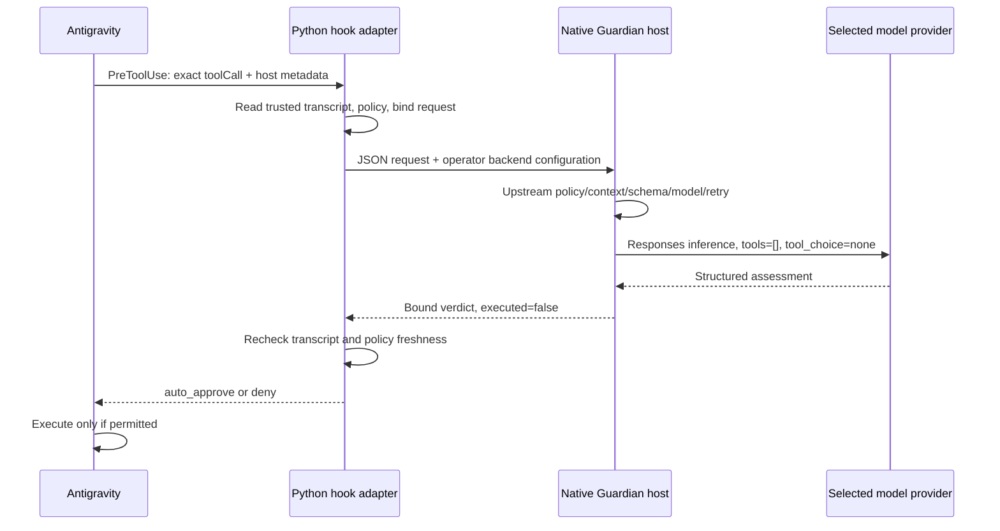

# Implementation and upstream trace

Source: [openai/codex at the pinned revision](https://github.com/openai/codex/tree/970111f6cb62cc02fe36a82ea7d71b37a2889c97). Product behavior was checked against [Auto-review documentation](https://developers.openai.com/codex/sandboxing/auto-review); hook integration against [Antigravity hooks](https://antigravity.google/docs/hooks/).

## Source borrowing

The separate `native` Cargo workspace uses Codex crates directly as Git dependencies pinned to that commit. The Guardian reviewer and context crates are not published on crates.io (both registry API lookups returned 404 when checked on 2026-10-25), so Cargo fetches the upstream repository into its normal cache and builds the selected libraries from source. There is no copied Codex source tree in this repository and no Codex fork or reviewer patch.

`native/Cargo.lock` pins the complete dependency graph. `upstream.lock.json` records the Codex revision, and `scripts/build.py` checks every direct Codex crate against that pin before invoking a locked Cargo build. A first build needs network access to fetch dependencies; subsequent builds can reuse Cargo's cache. The adapter does not build Codex's CLI or terminal UI.

Codex's normal third-party dependencies are still resolved by Cargo. The adapter retains the two pinned OpenAI websocket fork overrides used by upstream, which supply its websocket features; these are Cargo dependencies, not copied source files. All other third-party registry versions were retained when moving from the original source snapshot to Git dependencies.

### Why the upstream notice mentions Ratatui

Codex itself contains a terminal implementation derived from Ratatui in `codex-rs/tui/src/custom_terminal.rs`. Its source header and the upstream NOTICE carry that attribution. `UPSTREAM_NOTICE` preserves Codex's notice, including that entry. The adapter's resolved dependency graph contains neither `ratatui` nor `codex-tui`.

The initial implementation copied the entire Codex snapshot, which unnecessarily brought in terminal UI source. That snapshot has been replaced by the pinned crate dependencies. The original 146 inspected Guardian/prompt files were byte-for-byte identical to the corresponding files fetched by Cargo at the same commit.

All four requested paths exist at the pin:

| Upstream component | Shipping responsibility | Bridge reuse |
| --- | --- | --- |
| `codex-rs/ext/guardian-reviewer` | Review orchestration, model selection, result contract/parser, retry/deadline, completion/reporting, reviewer session lifecycle | Calls `select_review_model`, `guardian_output_schema`, `guardian_output_contract_prompt`, `parse_guardian_assessment`, `run_with_retry`, `ReviewDeadline`, `MAX_REVIEW_ATTEMPTS` directly |
| `codex-rs/guardian-context` | Evidence sections, source attribution, transcript selection/rendering, budget admission, exact action framing | Calls synchronous `ContextProfile`, `default_registry().prepare`, `compose`, `enforce_budget`, `effective_input_token_limit`, and `into_messages`; supplies `PlannedAction` and `PermissionContext` |
| `codex-rs/core/src/guardian` | Codex session/runtime adapter, action validation, capture/freshness, configuration, model client, inherited environment and reviewer lifecycle | Inspected as reference; no dependency on core or simulated main agent |
| `codex-rs/prompts/templates/guardian` | Default tenant policy, policy template, async classifier and REPL policy | Uses upstream model-message resolution and `GuardianPolicyInstructions`; does not use the async classifier as the blocking verdict |
| `codex-rs/model-provider`, `models-manager`, `login`, `codex-api`, `http-client` | Supported provider routing/catalog/authentication and Responses streaming | Reused directly for inference; no token-scraping transport |

## Shipping review flow

1. `core/src/guardian/runtime.rs` captures the immutable action and its issuing environment. `ReviewAction::validate` rejects missing/unavailable action environments. Approval routing selects the synchronous reviewer when required; routine sandbox-permitted actions normally do not invoke it.
2. `core/src/guardian/reviewer_config.rs::resolve_review_model` obtains the provider’s preferred review model and current available model presets. `ext/guardian-reviewer/src/model.rs::select_review_model` honors parent model metadata’s `auto_review_model_override`, prefers low reasoning effort when supported, and has an upstream parent fallback. `model-provider/src/provider.rs` selects `codex-auto-review` normally and `gpt-5.6-luna` for API-key auth at this pin; specialized providers can use different model IDs.
3. `build_guardian_review_session_config` resolves model-owned auto-review text plus runtime policy configuration. `prompts/src/guardian_instructions.rs::GuardianPolicyInstructions` combines the template, effective tenant policy, optional extra policy, transcript-format instructions and output contract. Configuration can override tenant policy; managed requirements have precedence in the full product.
4. `core/src/guardian/prompt.rs` collects parent history, verified user answers/root instructions, the exact approval request, permission denials and optional REPL evidence. `guardian-context` keeps roles and provenance, applies synchronous retention and framing, and bounds the full request without truncating the proposed action. Input-budget recovery in core can compact/restart the runtime context.
5. `core/src/guardian/review_session_setup.rs` and `review_session.rs` capture/reuse a reviewer session with the parent’s relevant state. The reviewer receives read-only permissions, no approval escalation, and a limited tool policy from `ext/guardian-reviewer/src/settings.rs`. It may gather read-only evidence before its structured final answer.
6. `ext/guardian-reviewer/src/execution.rs`, core’s reviewer runtime and model client run the selected model. The inference response is parsed through `assessment.rs`; the output schema accepts `allow` or `deny`. Upstream deliberately tolerates surrounding prose and supplies defaults for omitted risk/authorization/rationale fields. This bridge calls that same parser unchanged.
7. `retry.rs` applies up to three attempts within the shared deadline. Parse failures and selected transient service errors are retryable. Explicit model denials, auth/model-not-found errors, cancellations and deadline expiry are not converted to approvals. `completion.rs` distinguishes an assessment from a review failure, maps outcomes to decisions, and generates reporting/feedback. Full Codex also tracks repeated denials and offers narrow user overrides.

## Review-only host

The bridge supplies evidence the upstream libraries need without creating a main Codex thread or submitting the proposal to an execution API:

`native/src/main.rs` is the new host entry point. It supplies upstream `ResponseItem` evidence, original authorization, immutable planned action, synchronous JSON transcript profile, permission context and request budget. It uses the selected model’s catalog policy messages with bundled fallbacks, keeping the original policy template and output contract. Operator environment/permissions are also included intact; optional caller evidence is explicitly untrusted and retained as complete input.

The native host uses upstream authentication/provider/client code and receives Responses events directly. No tool dispatcher exists. Proposed commands are data on stdin and in model input, never process arguments or shell code. Model tool calls are not dispatched. The only subprocess in the Python adapter is the fixed native binary. The optional live Antigravity test separately invokes `agy` to prove the executor-side behavior.

The native entry point accepts NDJSON envelopes with `mode` (`doctor`, `prepare`, `review`), `config` and `request`. It can process repeated lines, though the public CLI uses a fresh process per action to avoid cross-session state or verdict reuse. Stdout contains JSON only. The internal native interface trusts its host; use the public Python interface for transcript validation and Antigravity enforcement.

## Authorization and binding

The public request names the Antigravity session and transcript path. The configured app-data root pins the canonical conversation log (`transcript.jsonl` from the docs or `transcript_full.jsonl` observed in CLI 1.4.7); workspace paths in action arguments cannot choose an alternative transcript. The loader rejects symlinks, shared-writable/user-mismatched paths, incomplete JSON records, missing explicit user records and known-truncated authorization. JSON duplicate fields and non-finite values are rejected.

For the observed Antigravity transcript format, `type=USER_INPUT`, `source=USER_EXPLICIT`, `status=DONE` is a genuine user message. Other sources cannot authorize actions. Planner records remain assistant evidence; generic model/tool results remain tool evidence with their original `type`, `source`, timestamp, step and log position attached. Nested text that says `user:` or contains `userMessage` never becomes a user record. No hidden reasoning is collected.

The host constructs:

- unique request ID and session ID;
- exact tool name and arguments, without shell parsing or rewriting;
- cwd and relevant execution metadata;
- original trusted user request and source-attributed history;
- operator-supplied permission/policy context;
- additional untrusted evidence;
- binding hash over the complete normalized request, transcript digest and operator config digest.

The response must match both request ID and binding. Approval also requires a completed upstream allow assessment and `executed=false`. The adapter re-reads transcript and config before returning approval. No verdict cache or transferable approval token is used. Request IDs should be unique; repeated submission always incurs a new review and creates no replay grant.

An optional `audit_path` records time, IDs/hashes, model/backend metadata, outcome, risk and authorization, without command text or transcript contents. Installation merges a named hook into the workspace configuration; `uninstall --workspace` removes only that hook and does not require backend credentials or the operator config. The hook response uses exactly the Antigravity schema. Valid model denials and review failures both gate execution, but reasons distinguish them. Errors always produce valid deny JSON and exit 0 for the hook; other CLI commands return a nonzero status on failure.

This assumes host logs and operator configuration are protected by the actual execution environment. User ownership and a canonical path are not cryptographic proof against an unrestricted process with the same identity. Agent-generated actions must not be allowed to rewrite these files. Antigravity’s own sandbox remains responsible for execution isolation and resource rules.

## Deliberate runtime differences

This implementation does not claim shipping-product equivalence. It has no read-only investigation tools; an action needing absent file contents can be denied conservatively. It does not import a Codex parent checkpoint, retained developer state, managed requirements, plugin descriptions, user override markers or enterprise config automatically. It does not implement async risk scoring, cached approvals, reviewer pooling, product telemetry, history compaction or Codex’s per-turn denial circuit breaker. Each pending Antigravity action is reviewed, including those that Codex would normally run without review inside its sandbox.

The adapter requires explicit operator model selection when an unavailable preferred model would otherwise trigger a different parent fallback. It reports the requested reviewer model, preferred model, catalog availability and explicit override. `server_model` is reported when the upstream transport exposes that header; absence does not prove an underlying model snapshot. Live success proves this account can perform review inference at the time tested, not universal model availability or an unchanged product rollout.

Antigravity hook crashes/timeouts outside the adapter are controlled by the host. The adapter’s own deadline precedes the installed hook timeout, and normal failures return deny. The actual CLI validation checks observable gating; no claim is made that all Antigravity versions enforce every abnormal hook failure identically. Inspect other installed hooks: argument-overwriting hooks after this gate can invalidate what was reviewed. Avoid later argument mutation, or move this gate last in the effective hook order.
